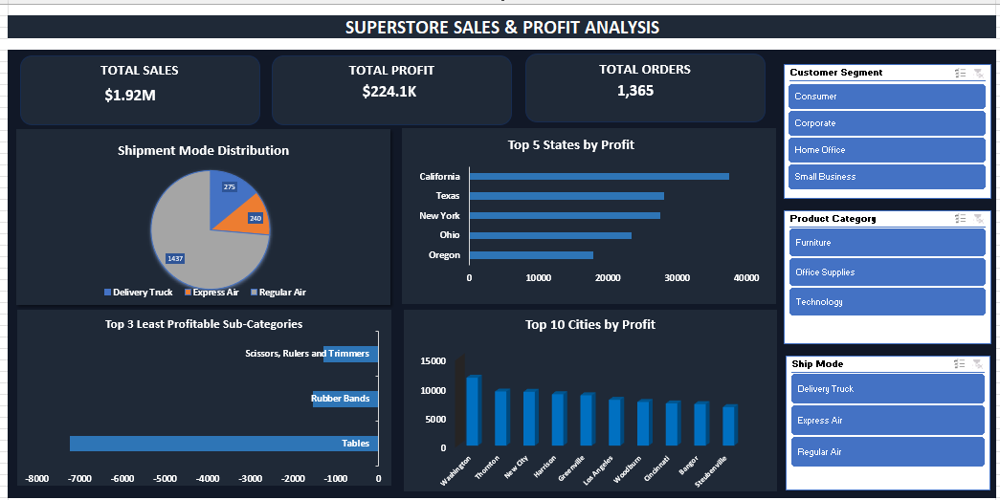

Superstore Sales & Profit Analysis Dashboard

Project Overview
An interactive Excel dashboard developed to analyze Superstore sales, profit, orders, shipment modes, and business performance.

Dashboard Preview

Key Performance Indicators (KPIs)
  Total Sales:  $1.92M
  Total Profit: $224.1K
  Total Orders: 1,365

Dashboard Features
 Shipment Mode Distribution
 Top 5 States by Profit
 Top 3 Least Profitable Sub-Categories
 Top 10 Cities by Profit
 Interactive slicers for Customer Segment, Product Category, and Ship Mode

Tools Used
 Microsoft Excel
 PivotTables and PivotCharts
 Slicers
 Dashboard Design and Data Analysis

How to Use
1. Download `Superstore_Sales_Profit_Dashboard.xlsx`.
2. Open the workbook in Microsoft Excel.
3. Use the slicers to explore the dashboard.

Project Files
 Superstore_Sales_Profit_Dashboard.xlsx — Excel dashboard
 dashboard-preview.png — Dashboard screenshot
